<!-- Galaxy Profile README
     Put this file at the root of github.com/TyraNyamburaa/TyraNyamburaa
     The images below live in assets/generated/ and are produced by the
     template's generator (GitHub Actions workflow, or: python -m generator.main).
     Until the generator has run once, the images will show as broken. -->

  <picture>
    <source media="(max-width: 600px) and (prefers-color-scheme: light)" srcset="./assets/generated/galaxy-header-mobile-light.svg">
    <source media="(max-width: 600px)" srcset="./assets/generated/galaxy-header-mobile.svg">
    <source media="(prefers-color-scheme: light)" srcset="./assets/generated/galaxy-header-light.svg">
    
  </picture>

 

  <picture>
    <source media="(max-width: 600px) and (prefers-color-scheme: light)" srcset="./assets/generated/stats-card-mobile-light.svg">
    <source media="(max-width: 600px)" srcset="./assets/generated/stats-card-mobile.svg">
    <source media="(prefers-color-scheme: light)" srcset="./assets/generated/stats-card-light.svg">
    
  </picture>

 

  <picture>
    <source media="(max-width: 600px) and (prefers-color-scheme: light)" srcset="./assets/generated/tech-stack-mobile-light.svg">
    <source media="(max-width: 600px)" srcset="./assets/generated/tech-stack-mobile.svg">
    <source media="(prefers-color-scheme: light)" srcset="./assets/generated/tech-stack-light.svg">
    
  </picture>

 

  <picture>
    <source media="(max-width: 600px) and (prefers-color-scheme: light)" srcset="./assets/generated/projects-constellation-mobile-light.svg">
    <source media="(max-width: 600px)" srcset="./assets/generated/projects-constellation-mobile.svg">
    <source media="(prefers-color-scheme: light)" srcset="./assets/generated/projects-constellation-light.svg">
    
  </picture>

 

<strong>More about me</strong>

 

Software engineer building AI-powered and full-stack applications with Python, FastAPI, React and Next.js.
I work on backend systems, data/ML projects, automation and security-minded engineering.

**Currently learning:** production ML / MLOps, system design, cloud infrastructure and security.
**Looking to collaborate on:** open-source projects in backend engineering, ML/data, security or developer tooling.
**Ask me about:** Python, backend development, data pipelines, ML APIs, databases, automation and cybersecurity.

**Fun fact:** I can spend an unreasonable amount of time trying to understand why something works when I could have just accepted that it does.

 

  <!-- Add your email here if you want it public:
  
  -->
  

